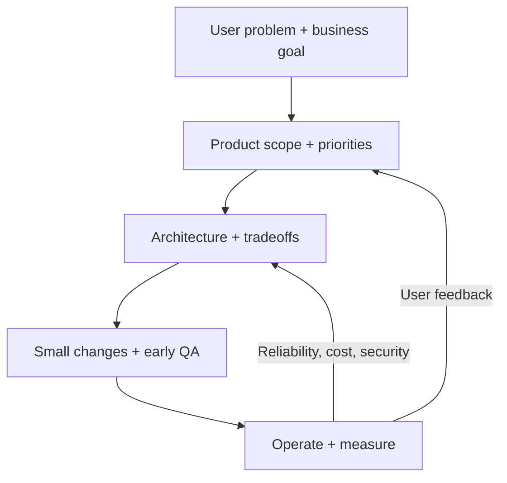

# KC Chan

**Engineering leadership · Product development · Systems architecture**

### I build products and the engineering teams that scale them.

I'm an engineering leader who has worked across startups, enterprise organizations, SaaS, digital publishing, and government technology. My background spans software development, architecture, cloud infrastructure, cybersecurity, and carrier networks.

The thread through all of it: technical decisions are business decisions. Architecture choices show up later as delivery speed, reliability, operating costs, and how easily the next team can maintain the system. I try to make those tradeoffs visible early, while they're still cheap to change, and I stay close enough to the code and the customers to know when a plan needs to shift.

## Selected impact

| 400,000+ | 30+ | 3 continents |
|:---:|:---:|:---:|
| platform users | people across engineering and operations | platform footprint |

- Helped scale an international communications platform to 400,000+ users across three continents and supported its growth through acquisition.
- Built and led a 30+ person engineering and operations organization, owning architecture, delivery, vendors, and platform reliability.
- Delivered transaction processing and reconciliation capabilities supporting millions of dollars in financial activity.
- Built secure government-facing applications with identity, authorization, accessibility, and auditability requirements.

## Products and projects

Current independent work, separate from the impact above.

| Project | What it does |
|---|---|
| [System Design Lab](https://kchan1028.github.io/system-design-lab/) · [Source](https://github.com/kchan1028/system-design-lab) | Original architecture case studies with explicit constraints, failure handling, capacity assumptions, and decision records. |
| [FedPath](https://gofedpath.com) | Helps small businesses discover government opportunities and work through bid decisions and proposal preparation. |
| [Useful Little Tools](https://usefullittletools.app) | Practical tools for developers, engineering teams, and people learning technical concepts. |
| [Berkeley Omnium](https://berkeleyomnium.com) | Community cycling event website, built and maintained with a focus on clear information and mobile usability. |
| [kalunchan.dev](https://kalunchan.dev) | Portfolio and writing on engineering leadership, architecture, delivery, and lessons from building products. |

## How I work

Good delivery is a loop. What happens in production should change what the team builds next and how it builds it.

- Start with the user problem and business outcome.
- Choose architecture the team can operate and maintain.
- Deliver small, reviewable changes and involve QA early.
- Treat security, reliability, and operating costs as product decisions.
- Use AI with evaluation and appropriate human review.

## Technical background

**Application development:** Python, Django, FastAPI, TypeScript, React, Next.js, Ruby on Rails

**Data and messaging:** PostgreSQL, Redis, Celery, Kafka

**Infrastructure and delivery:** AWS, Terraform, Docker, GitHub Actions

**Systems:** Distributed systems, event-driven architecture, identity and authorization, document workflows

## Beyond engineering

I ride bikes and help organize community bike racing, including the [Berkeley Omnium](https://berkeleyomnium.com). Race days run on the same things good platforms do: clear information, planning for what can go wrong, and volunteers who know their roles.

## Contact

Work history, writing, and contact details are at **[kalunchan.dev](https://kalunchan.dev)**. You can also find my work through [Yippify](https://yippify.com).
