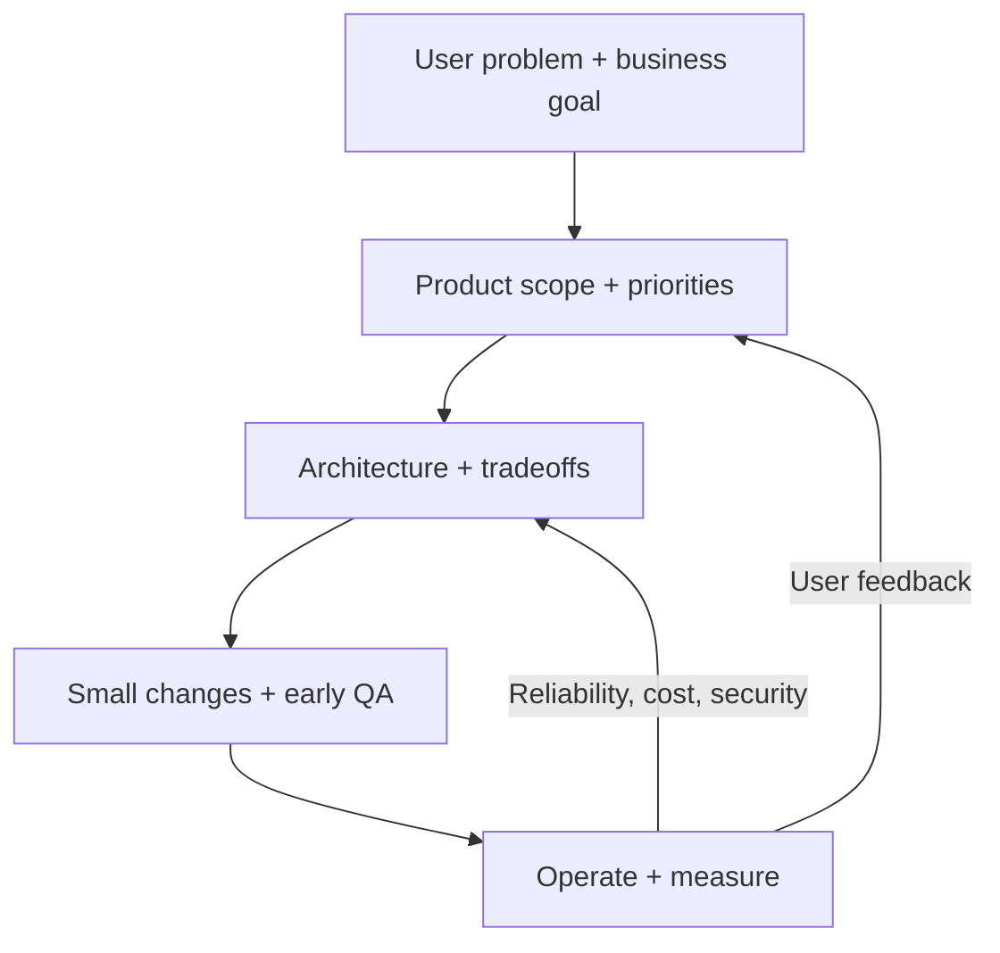

# KC Chan

**Engineering Leadership · Product Engineering · Systems Architecture**

### I build products and the engineering teams that scale them.

I'm an engineering leader who has worked across startups, enterprise organizations, SaaS, digital publishing, and government technology. My background spans software development, architecture, cloud infrastructure, cybersecurity, and carrier networks.

Technical decisions are business decisions. Architecture choices show up later as delivery speed, reliability, operating costs, and how easily the next team can maintain the system. I make those tradeoffs visible early, while they're still cheap to change, and I stay close enough to the code and the customers to know when a plan needs to shift.

## Featured engineering work

Each repository documents its decisions, test coverage and known limitations alongside the code.

### [Masters Cycling Lab](https://github.com/kchan1028/masters-cycling-lab)

**Problem:** AI answers about research are hard to trust when you can't see which passage they came from.

**What it does:** Upload research PDFs, search them, and ask questions. Every claim in an answer cites the exact passage and PDF page, and the server rejects citations to passages the model wasn't given.

**Decisions:** No RAG framework, so retrieval and citation checks stay inspectable. PostgreSQL doubles as a leased job queue. Exact pgvector search comes before approximate indexes. Answers work with any OpenAI-compatible model.

**Evidence:** 74 human-reviewed test questions across dev and held-out splits. Paper-level recall is close to target, and passage-level recall is the documented weakness.

**Stack:** Python, FastAPI, PostgreSQL + pgvector, React, TypeScript, Docker Compose · [Evaluation](https://github.com/kchan1028/masters-cycling-lab/blob/main/docs/evaluation.md) · [Decision records](https://github.com/kchan1028/masters-cycling-lab/tree/main/docs/decisions)

### [Sprint Progress Analyzer](https://github.com/kchan1028/sprint-progress-analyzer)

**Problem:** Sprint reviews drift into status reading when nobody can see how scope changed or where work is stuck.

**What it does:** Imports a Jira CSV in the browser and shows commitment versus current scope, blocked and aging work, and missing estimates, with explainable risk signals.

**Decisions:** Local-first, with no backend and no Jira credentials. Pure calculation functions are tested separately from the UI. Risk signals show their thresholds. It's a heuristic, not a forecast.

**Evidence:** Unit tests for parsing and scope accounting, Playwright and axe checks for the import journey, and a documented list of data limitations. The demo data is synthetic.

**Stack:** TypeScript, React, Vite, Vitest, Playwright · [Case study](https://github.com/kchan1028/sprint-progress-analyzer/blob/main/docs/product-case-study.md) · [User guide](https://github.com/kchan1028/sprint-progress-analyzer/blob/main/docs/user-guide.md)

### [System Design Lab](https://github.com/kchan1028/system-design-lab)

**Problem:** Most system design write-ups skip the failure modes, security boundaries and operating costs that decide whether a design works.

**What it does:** Six original case studies: a voice platform, document processing, event-driven orders, multi-tenant SaaS, a high-traffic API and RAG search. Each has requirements, trust boundaries, failure handling, cost reasoning and ADRs.

**Decisions:** Assumptions are labelled, and capacity arithmetic is never called a benchmark. A deterministic simulation exercises the failure scenarios for one study.

**Stack:** TypeScript, React, Mermaid, GitHub Pages · [Read the studies](https://kchan1028.github.io/system-design-lab/)

## Selected impact

| 400,000+ | 30+ | 3 continents |
|:---:|:---:|:---:|
| platform users | people across engineering and operations | platform footprint |

- Helped scale an international communications platform to 400,000+ users across three continents and supported its growth through acquisition.
- Built and led a 30+ person engineering and operations organization, owning architecture, delivery, vendors, and platform reliability.
- Delivered transaction processing and reconciliation capabilities supporting millions of dollars in financial activity.
- Built secure government-facing applications with identity, authorization, accessibility, and auditability requirements.
- Integrated Snowflake Document AI into production document workflows with human review.

## How I work

Good delivery is a loop. What happens in production should change what the team builds next and how it builds it.

- Start with the user problem and business outcome.
- Choose architecture the team can operate and maintain.
- Deliver small, reviewable changes and involve QA early.
- Treat security, reliability, and operating costs as product decisions.
- Use AI with evaluation and appropriate human review.

## Technical capabilities

**Application engineering:** Python, Django, FastAPI, TypeScript, React, Next.js, Ruby on Rails

**Distributed systems and data:** PostgreSQL, Redis, Celery, Kafka, event-driven architecture, job queues and idempotent processing

**Cloud and infrastructure:** AWS, Terraform, Docker, GitHub Actions, carrier networks

**Security and reliability:** Identity and authorization, auditability, accessibility, threat modelling, failure recovery

**Applied AI and evaluation:** Retrieval-augmented generation, pgvector, retrieval evaluation, Snowflake Document AI, human review in document workflows

## Products

- [FedPath](https://gofedpath.com): helps small businesses discover government opportunities and work through bid decisions and proposal preparation.
- [Useful Little Tools](https://usefullittletools.app): practical tools for developers, engineering teams, and people learning technical concepts.
- [Berkeley Omnium](https://berkeleyomnium.com): a community cycling event website, built for clear information and mobile use.

## Beyond engineering

I ride bikes and help organize community bike racing, including the Berkeley Omnium.

## Contact

Work history, writing, and contact details are at **[kalunchan.dev](https://kalunchan.dev)**. You can also find my work through [Yippify](https://yippify.com).
